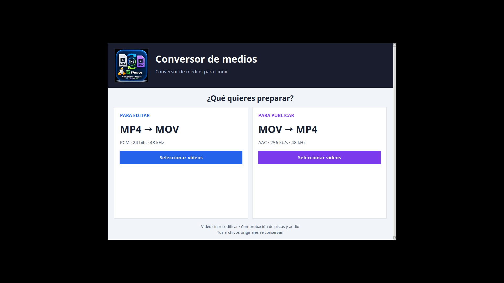
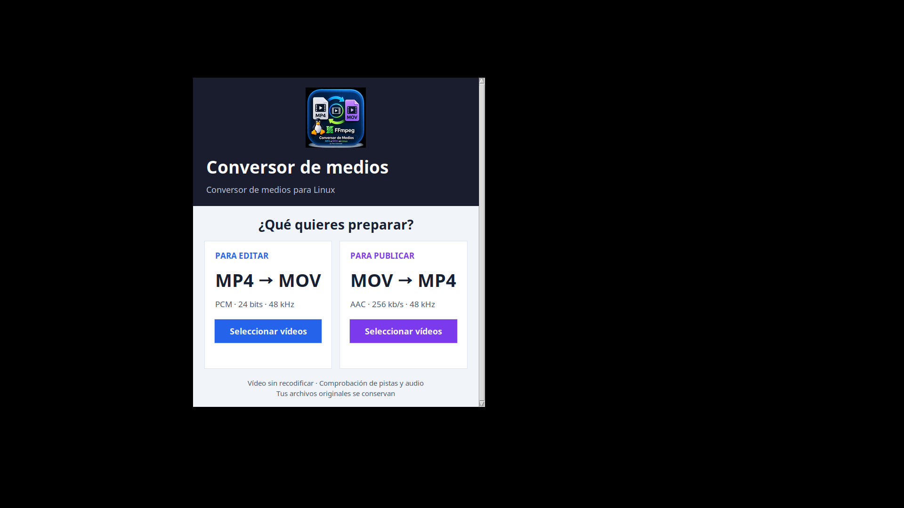

# Conversor de medios para Linux

Aplicación gráfica con dos modos: **MP4 → MOV con PCM** para editar en
DaVinci Resolve y **MOV → MP4 con AAC** para publicar. En ambos modos conserva
el vídeo sin recodificar; la conversión del audio a AAC es con pérdida.

La pantalla inicial muestra el icono oficial firmado **«by Paco Estrada»** y
distingue con azul la edición y con violeta la publicación. La ventana arranca
centrada en el monitor del puntero, hasta 1100 × 750 unidades de diseño según el área disponible y el escalado HiDPI. Los textos se ajustan
y las tarjetas pasan a una columna cuando falta anchura; en ventanas muy pequeñas
se puede desplazar el contenido verticalmente.

Permite seleccionar uno o varios archivos, o una carpeta completa con sus
subcarpetas. Copia el vídeo sin recodificar y convierte todas las pistas de audio
a PCM de 24 bits a 48 kHz, compatible con DaVinci Resolve en Linux.
En el sentido inverso convierte todas las pistas a AAC a 256 kb/s y 48 kHz.

Antes de anunciar éxito, comprueba las pistas, los canales y el formato PCM o AAC,
lee todo el audio para detectar errores y compara la huella del vídeo comprimido
con el original. Una señal verde indica conversión verificada; una señal roja
indica fallos y muestra el motivo. Si el origen no tiene audio, no lo inventa.
La señal verde confirma estas comprobaciones; no sustituye una prueba en Resolve.

El vídeo HEVC/H.264 se conserva: su importación depende de la edición de Resolve
y del hardware. Esta versión no recodifica vídeo automáticamente.

## Así es el conversor

### Elige qué quieres preparar



- **Para editar (azul):** prepara MP4 como MOV con audio PCM de 24 bits a 48 kHz para trabajar en DaVinci Resolve en Linux.
- **Para publicar (violeta):** convierte MOV compatibles a MP4 con audio AAC de 256 kb/s a 48 kHz.

En ambos modos se copia el vídeo sin recodificar. Pulsa **Seleccionar vídeos**,
elige archivos o una carpeta y revisa el resumen al terminar. Los originales se conservan.

### También se adapta a ventanas más pequeñas



La cabecera se reorganiza y, cuando hace falta, las tarjetas pasan a una columna.
El desplazamiento vertical permite acceder al contenido si no cabe en la ventana.

*Capturas reales de la interfaz 2.3.5 tomadas durante las pruebas en un escritorio virtual Linux.
El aspecto de los bordes de ventana puede variar según el escritorio.*

## Descargar e instalar

Descarga la última versión desde la página de
[**Releases**](https://github.com/pacoestrada/conversor-medios-davinci-linux/releases/latest).

El archivo que necesitas es:

- Debian, Ubuntu o Linux Mint: `conversor-mp4-mov_2.3.5_all.deb`
- Fedora, Rocky Linux, AlmaLinux o RHEL:
  `conversor-mp4-mov-2.3.5-1.noarch.rpm`

### Instalación gráfica

Haz doble clic sobre el archivo `.deb` descargado y pulsa **Instalar**.

### Instalación desde la terminal

Abre una terminal en la carpeta donde lo has descargado y ejecuta:

```bash
sudo apt install ./conversor-mp4-mov_2.3.5_all.deb
```

En Fedora, Rocky Linux, AlmaLinux o RHEL:

```bash
sudo dnf install ./conversor-mp4-mov-2.3.5-1.noarch.rpm
```

El instalador añadirá automáticamente las dependencias necesarias.

## Cómo usarlo

1. Abre **Conversor de medios · Compilando** desde el menú de aplicaciones.
2. Elige **Para editar** o **Para publicar**.
3. Selecciona una carpeta o uno o varios archivos.
4. Espera y revisa el resumen de archivos convertidos, omitidos y fallidos.

Los archivos se guardan junto a sus originales, con la extensión del destino.
Si el archivo de destino ya existe, la aplicación lo omite y no lo sobrescribe. Los omitidos no se validan.
Para repetir un MP4 convertido con la versión anterior, mueve o renombra su MOV
antiguo antes de convertir; así se conserva la copia anterior.

## Funciones principales

- Selección gráfica de archivos o carpetas completas.
- Búsqueda de MP4 o MOV en todas las subcarpetas.
- MOV a MP4 con AAC a 256 kb/s.
- Pantalla inicial adaptable, con el icono propio y tarjetas que se reorganizan en vertical.
- Audio PCM de 24 bits a 48 kHz en todos los archivos con audio.
- Vídeo siempre intacto, incluso cuando el audio necesita conversión.
- Indicador gráfico de progreso.
- Señal verde tras verificar la salida o roja si hay fallos.
- Resumen final de convertidos, omitidos y fallidos.
- Explicación útil para cada archivo que no se haya podido convertir.
- Eliminación automática de salidas incompletas.
- Icono y lanzador integrados en el menú de aplicaciones.

## Vídeo compatible con MP4

Este modo no convierte el vídeo a H.264: copia el que contenga el MOV.
H.264 es la opción habitual para difusión. Si DaVinci exportó ProRes o DNxHR
y FFmpeg no puede copiarlos a MP4, la aplicación informa del fallo y elimina
la salida temporal. Exporta desde DaVinci con vídeo compatible con MP4 para
usar este modo. No se recodifica el vídeo automáticamente.

## Requisitos

- Debian, Ubuntu, Linux Mint, Fedora, Rocky Linux, AlmaLinux o RHEL
  o una distribución compatible con paquetes `.deb` o `.rpm`.
- FFmpeg, Zenity, Python 3 y Tkinter, instalados como dependencias.

## Desinstalar

```bash
sudo apt purge conversor-mp4-mov
```

## Para desarrolladores

Construir el paquete Debian:

```bash
bash packaging/build-deb.sh
```

Ejecutar las pruebas automáticas:

```bash
bash tests/test_v2.sh
bash tests/test_v2_2.sh
xvfb-run -a -s "-screen 0 1366x768x24" python3 tests/test_gui.py
```

Construir el paquete RPM:

```bash
bash packaging/build-rpm.sh
```

## Versión anterior

La documentación y las descargas de la antigua versión 1.3 siguen disponibles
en la [release v1.3](https://github.com/pacoestrada/conversor-medios-davinci-linux/releases/tag/v1.3).

Para ejecutar la pantalla inicial desde el código: `python3 src/conversor-gui.py`.
El script `convertir_medios.sh` mantiene un acceso alternativo con Zenity.

## Licencia

Distribuido bajo la licencia MIT.

El logo de Compilando Podcast pertenece a su titular; véase `data/LOGO.md`.

## Publicación de versiones

GitHub Actions comprueba el motor, ambas conversiones y la pantalla inicial,
construye el `.deb` y el `.rpm` y crea la release correspondiente a la versión del paquete.
Incluye el instalador y `SHA256SUMS.txt`; GitHub añade los archivos de código fuente.
Las notas de esta versión están en `docs/releases/v2.3.5.md`.
Una release existente no se sobrescribe. Ambos paquetes se publican juntos con sus sumas SHA256.
